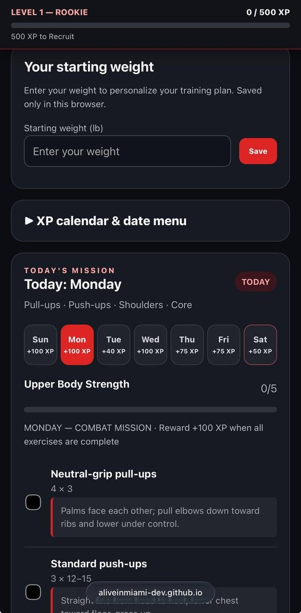
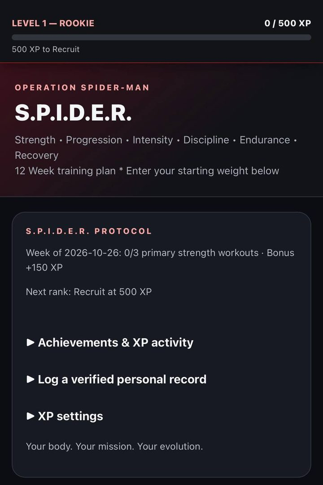
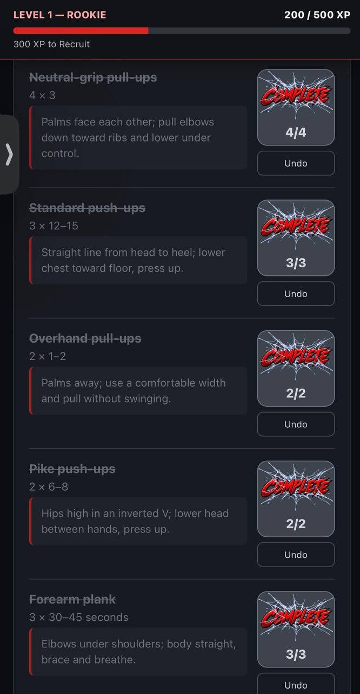

# Operation Spider-Man 🕷️

**A single-file, offline-first workout tracker that turns a 12-week training plan into a game you actually want to play.**

No accounts. No backend. No analytics. No build step. Just one HTML file and your browser.

### ▶️ **[Open the live app](https://aliveinmiami-dev.github.io/operation-spiderman/)**


---

## Screenshots

  

---

## What it does

- **Daily missions** — a full 12-week plan with strength, conditioning, active recovery and a mandatory rest day. Each day lists its exercises, set targets, and coaching cues.
- **Per-set tracking** — tap once per set instead of checking a box. The button shifts through stages and locks grey when the set is complete. Undo is one tap, because mis-taps happen mid-workout.
- **XP and levels** — work pays out in XP: 100 for the big days, 75 for conditioning, 40 for recovery, and a bonus for hitting Monday/Wednesday/Sunday in one week. Levels, achievements, and a running activity log.
- **Verified personal records** — log a clean single set for pull-ups or push-ups, confirm it was one continuous set, and earn XP for your first best and every improvement after.
- **XP calendar heatmap** — every day of the month colored by effort, plus your highest-XP days. Select any past date to fix a forgotten check-in. Future dates are view-only.
- **Bodyweight log** — starting weight plus weigh-in history, tracked as a trend rather than a daily mood swing.
- **Backup and restore** — export your entire history as JSON and import it on another device. Imports are validated, deduped, and rolled back on failure. Existing local records always win conflicts.
- **Installable** — a real PWA with manifest, icons, and standalone display. Add it to your phone's home screen and it behaves like a native app.

## Privacy

Your data never leaves your device. There is no server, no account, no telemetry, and no third-party script. Everything lives in your browser's `localStorage`, which is also why the app ships a JSON export — clearing browser data or switching phones is the one thing that can lose your history.

## Install it on your phone

1. Open the [live app](https://aliveinmiami-dev.github.io/operation-spiderman/) in Safari (iOS) or Chrome (Android).
2. **iOS:** Share → *Add to Home Screen*. **Android:** menu → *Install app*.
3. Open it from your home screen — it runs fullscreen and works offline.

## Development

There is no framework, no bundler, and no dependency tree. The app is plain HTML, CSS, and vanilla JavaScript split across four files:

| File | Purpose |
| --- | --- |
| `index.html` | Markup, styles, plan data, and the main render loop |
| `xp-engine.js` | XP scoring, levels, streaks, achievements, and PR rules |
| `xp-ui.js` | XP bar, calendar, achievement and PR interface |
| `backup.js` | JSON export/import with validation and rollback |

Run the test suites (plain Node, no install required):

```bash
node xp-tests.cjs      # scoring, persistence, DST/year boundaries, streaks, PRs, reset safety
node backup-tests.cjs  # backup round trip, conflict preservation, malformed input, rollback
```

Both suites pass today. They cover the boring cases that actually break fitness apps: reload persistence, undo/recheck, Saturday idempotence, timezone and year boundaries, completed-log migration, and refusing to overwrite populated records with defaults.

### Data safety rules

This project treats your workout history as the most important thing in the codebase. Any contribution must preserve existing storage keys, migrate structures backward-compatibly, initialize only missing fields, never replace populated records with defaults, and keep `node xp-tests.cjs`/`node backup-tests.cjs` green. The full contract lives in [`AGENTS.md`](AGENTS.md).

## License

[MIT](LICENSE) — fork it, rename it, sell it, ship your own plan on top of it. Attribution appreciated, not required.

## Disclaimer

This is an **unofficial fan project**. It is not affiliated with, endorsed by, or sponsored by Marvel, Sony, or anyone who owns Spider-Man. The name and theme are a personal homage; the code is original.

The training plan and nutrition targets are one person's personal program, not medical advice. Talk to a doctor before starting a new routine, and stop if something hurts.
